<p align="center">
  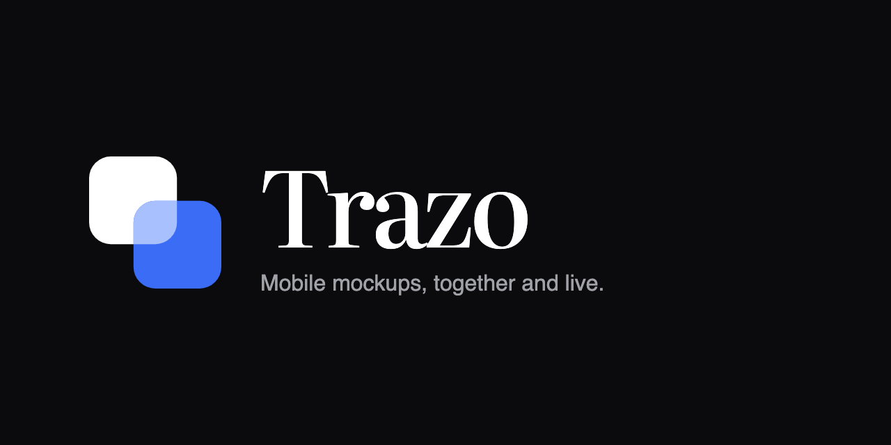
</p>

<p align="center">
  <b>Maquetas móviles rápidas y colaborativas, en el navegador.</b><br>
  Arma pantallas con más de 100 componentes, conéctalas en un flujo, preséntalas como prototipo<br>
  y deja que el equipo comente en el punto exacto, todos a la vez y en tiempo real.
</p>

<p align="center"><a href="README.md">English</a> · <b>Español</b></p>

<p align="center">
  <a href="LICENSE.md"></a>
  
  
</p>

---

Trazo nació para reemplazar el papel en las reuniones de diseño de un equipo pequeño: en vez de bocetar en una hoja y fotografiarla, cada persona abre un enlace en su computadora, tablet o teléfono y todos dibujan, mueven y comentan sobre las mismas pantallas al mismo tiempo.

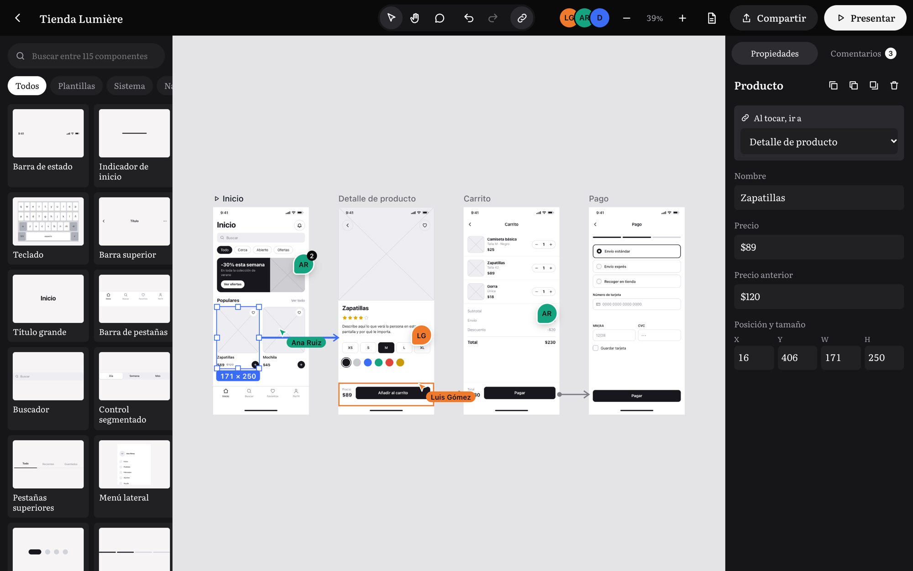

## Qué puedes hacer

**Diseñar rápido**
- **115 componentes** de wireframe listos: barras de sistema y navegación, botones, formularios, listas, tarjetas, gráficas, mapas, comercio (producto, carrito, pago, billete, QR), social (perfil, historias, publicación, notificaciones, videollamada), avisos y formas.
- **15 plantillas de pantalla completa** en un toque: inicio de sesión, inicio, detalle de producto, carrito, pago, perfil, ajustes, chat, mensajes, mapa, bienvenida, notificaciones, reserva, panel y estado vacío.
- Toca un componente y se apila debajo del último; o arrástralo a cualquier pantalla. Guías de alineación, ajuste a márgenes, deshacer y rehacer, copiar, pegar y duplicar.
- **Selector visual de iconos** (más de 120): sin escribir nombres técnicos.
- Pantallas de iPhone, Android, compacto y tablet, con fondo blanco, gris u oscuro.
- Dos estilos: **limpio** o **a mano**, para que se sienta como papel.

**Conectar y presentar**
- Elige un elemento y en "Al tocar, ir a" la pantalla destino: el lienzo dibuja la flecha del flujo.
- **Modo presentación**: navega el prototipo tocando, ideal para probarlo en el teléfono.

**Colaborar en vivo**
- Edición simultánea sin conflictos (CRDT con [Yjs](https://yjs.dev)): todos ven los cambios al instante.
- Cursores con nombre y color de cada persona; lo que otra persona selecciona o arrastra se ve en directo.
- Toca el avatar de alguien para ir a donde está trabajando.
- **Comentarios anclados** a un punto de la pantalla, con respuestas y "resuelto".

**Compartir y exportar**
- Enlace del equipo (puede editar) y **enlace de invitado de solo lectura**: ve, navega y comenta, pero no modifica nada (el servidor lo impone). Se puede desactivar y regenerar.
- **Exportar a PDF**: una página por pantalla con los comentarios numerados y los enlaces del flujo. También PNG por pantalla.

## Capturas

| | |
|---|---|
| 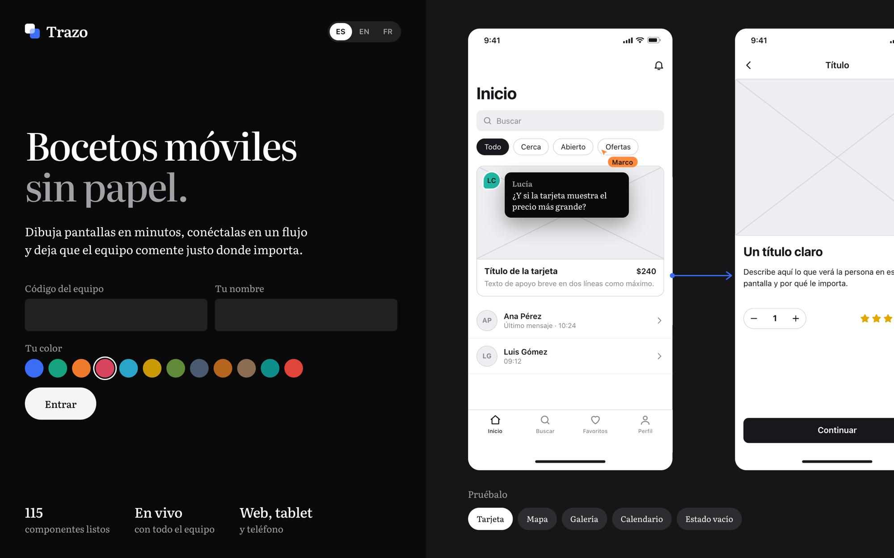 | 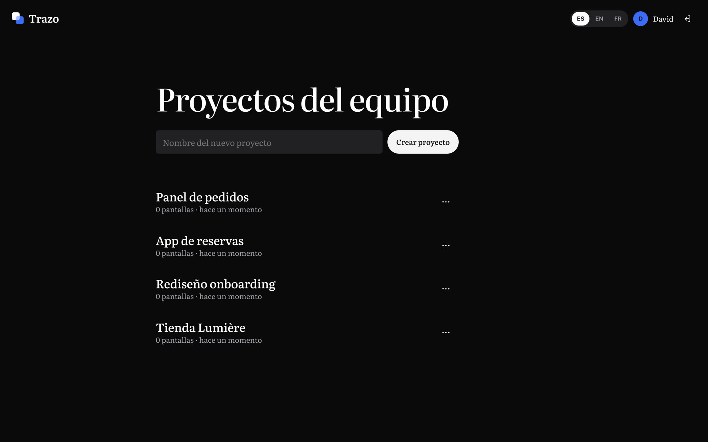 |
| **Ingreso**: código del equipo, tu nombre y tu color. | **Proyectos** del equipo. |
| 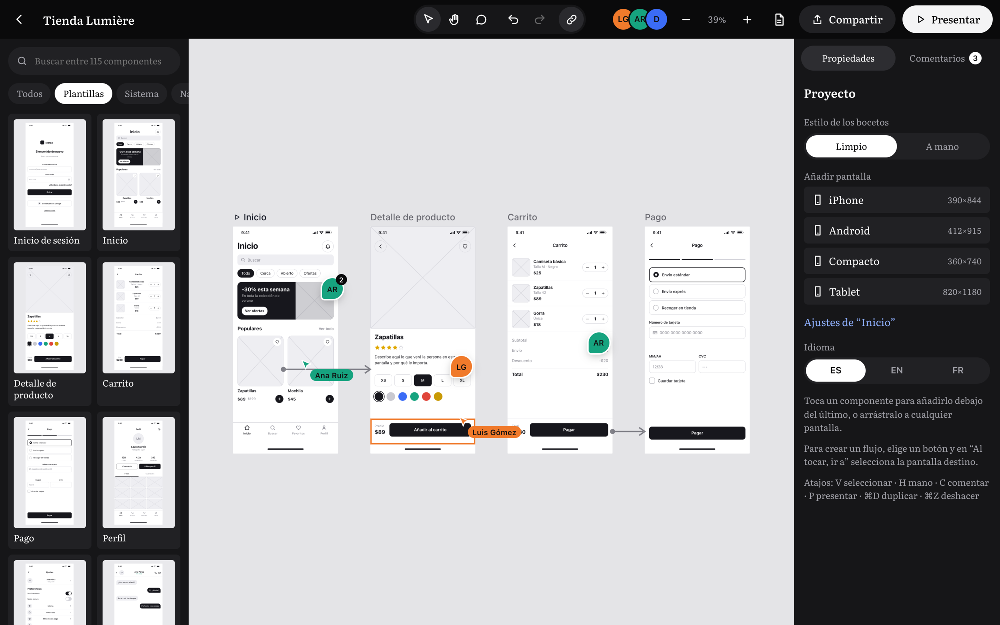 | 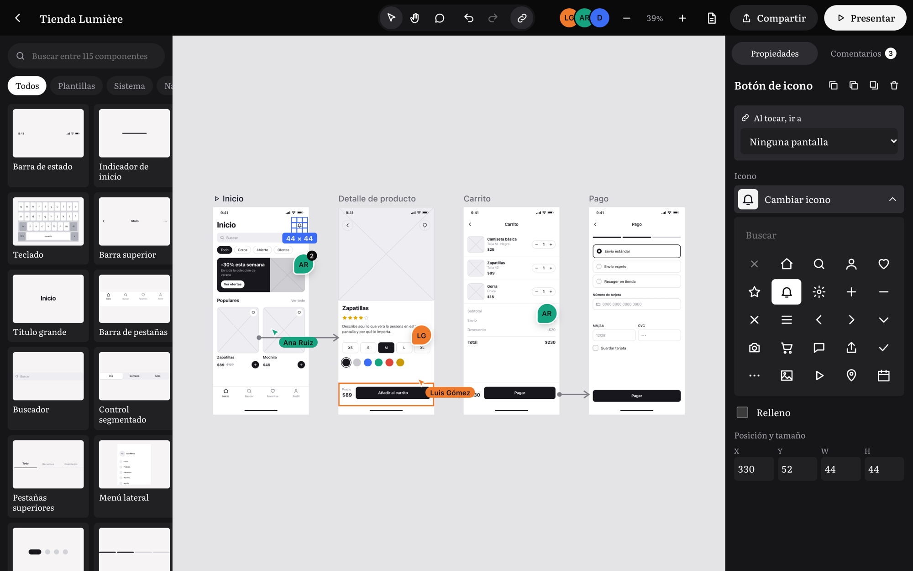 |
| **Plantillas** listas para editar. | **Iconos** elegidos visualmente. |
| 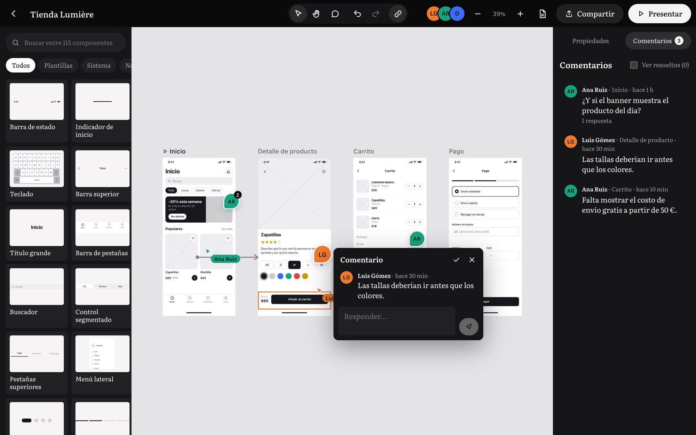 | 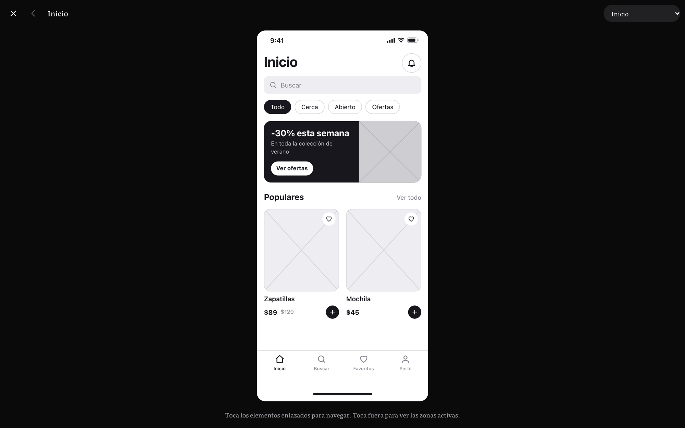 |
| **Comentarios** en el punto exacto. | **Presentación** del prototipo. |
| 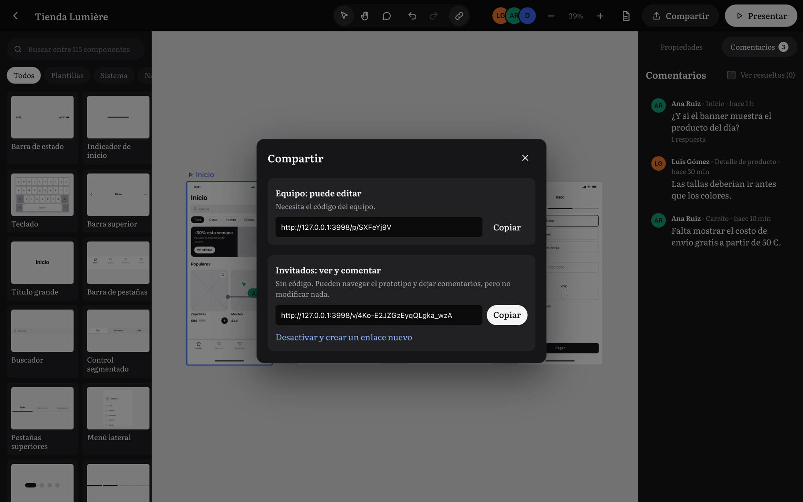 | 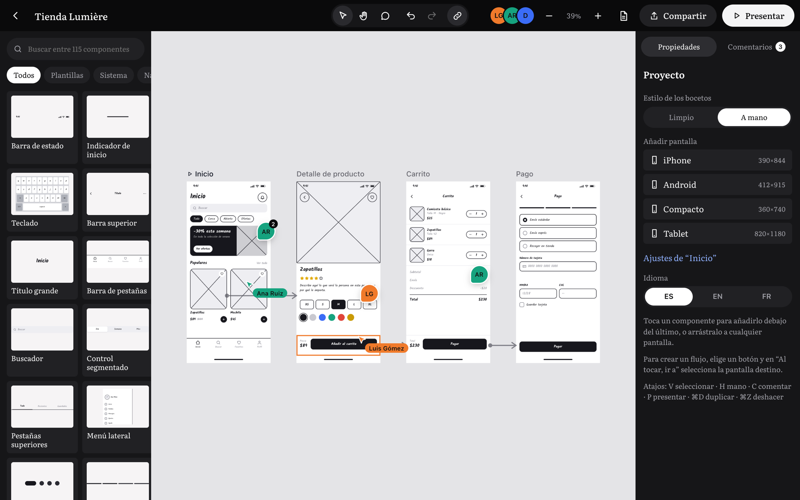 |
| **Compartir**: equipo o solo lectura. | Estilo **a mano**. |

<p align="center">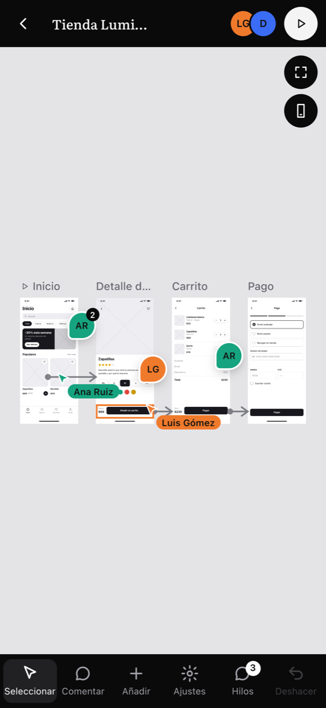<br><sub>También en el teléfono y la tablet: un dedo desplaza, dos dedos hacen zoom.</sub></p>

## Cómo funciona

```
 Navegador (React + Vite)                         Servidor (Node 24, un solo proceso)
 ┌───────────────────────────────┐   WebSocket   ┌──────────────────────────────────────┐
 │ Lienzo, paleta, inspector     │◄─────────────►│ Sala Yjs por proyecto                │
 │ Y.Doc compartido:             │  sync + pres. │  · difunde cambios y presencia       │
 │  screens · els · comments     │               │  · invitados: solo pueden comentar   │
 │ Presencia: cursor, selección, │     HTTP      │ API: acceso, proyectos, enlaces      │
 │ arrastre en vivo              │◄─────────────►│ SQLite (node:sqlite) en /data        │
 └───────────────────────────────┘               └──────────────────────────────────────┘
```

- **Tiempo real**: cada proyecto es un documento [Yjs](https://yjs.dev) sincronizado por WebSocket con el protocolo de `y-websocket`. La presencia (cursores, selección, arrastres) viaja por *awareness* y no se guarda.
- **Persistencia**: el servidor guarda el estado del documento en SQLite (módulo `node:sqlite` de Node, sin dependencias nativas), con escritura diferida de 1,5 s.
- **Acceso**: un código de equipo compartido crea una sesión firmada (cookie HttpOnly, 180 días). Los enlaces de invitado usan un token aleatorio por proyecto. El servidor comprueba que sus cambios solo toquen comentarios y desconecta a quien intente otra cosa.
- **Sin cuentas ni contraseñas personales**: cada persona escribe su nombre y elige un color.

## Ponerlo en marcha

Requisitos: **Node 24** o superior.

```bash
npm install
npm run build
TEAM_CODE=mi-codigo node --disable-warning=ExperimentalWarning server/index.mjs
```

Abre `http://localhost:3000` y entra con `mi-codigo`. Para desarrollar con recarga en caliente, deja el servidor corriendo y en otra terminal:

```bash
npm run dev
```

Vite sirve en `http://localhost:5173` y redirige `/api` y `/ws` al servidor.

### Variables de entorno

| Variable | Para qué sirve | Por defecto |
|---|---|---|
| `TEAM_CODE` | Código que el equipo escribe para entrar | `trazo` |
| `SECRET` | Firma de las sesiones; usa una cadena larga y aleatoria | aleatoria en cada arranque |
| `PORT` | Puerto HTTP | `3000` |
| `DATA_DIR` | Carpeta de la base SQLite | `./data` |
| `TRAZO_HOST` | Dominio público (solo para Docker + Traefik) | — |

## Desplegar con Docker

El `Dockerfile` compila el cliente y deja una imagen pequeña de Node. `docker-compose.yml` está preparado para un servidor con **Traefik** (red `proxy`, certificados de Let's Encrypt) y guarda los datos en el volumen `trazo_data`.

```bash
# en el servidor, junto a docker-compose.yml
cat > .env <<EOF
TEAM_CODE=un-codigo-para-tu-equipo
SECRET=$(openssl rand -hex 32)
TRAZO_HOST=trazo.tudominio.com
EOF
docker compose up -d --build
```

O desde tu equipo, con un alias SSH del servidor:

```bash
DEPLOY_HOST=mi-servidor TRAZO_HOST=trazo.tudominio.com ./deploy.sh
```

`deploy.sh` sube el código con `rsync`, crea `.env` la primera vez (con un código de equipo aleatorio) y reconstruye el contenedor usando una sola conexión SSH. Para ver o cambiar el código: `ssh mi-servidor 'cat /opt/trazo/.env'`.

¿Sin Traefik? Quita las `labels` y publica el puerto: `ports: ["3000:3000"]`, detrás de cualquier proxy con HTTPS y soporte de WebSocket.

## Pruebas de tiempo real

```bash
npm run test:realtime
```

Levanta una instancia aislada (puerto 3999, datos temporales) y simula varias personas: latencia de los cambios, convergencia de ediciones simultáneas, cursores y arrastres en vivo, permisos del enlace de invitado, revocación, reconexión tras reiniciar el servidor y persistencia en disco.

## Idiomas

Francés (por defecto), español e inglés, incluidos los nombres de los componentes y sus textos de ejemplo. Las cadenas viven en `src/i18n.ts`: la clave es el texto en español y cada idioma tiene su diccionario.

## Extender Trazo

- **Nuevo componente**: añade una entrada a `LIBRARY` en `src/library.tsx` (tipo, categoría, tamaño, propiedades por defecto, campos editables y `render`) y sus estilos `.wf-*` en `src/styles.css`. Aparece en la paleta, el buscador y el inspector automáticamente.
- **Nueva plantilla**: añade una lista de `[tipo, x, y, ancho, alto, props]` en `src/templates.ts` (pantalla de 390 × 844).
- **Nuevo icono**: añade su trazado SVG (24 × 24) en `src/icons.tsx`.
- **Traducciones**: añade la clave en español y su versión en los diccionarios `en` y `fr` de `src/i18n.ts`.

## Estructura

```
server/index.mjs       API, archivos estáticos y salas Yjs con SQLite
src/main.tsx           rutas: ingreso, proyectos, editor, enlace de invitado
src/store.ts           documento Yjs, deshacer, presencia y operaciones
src/library.tsx        catálogo de componentes
src/templates.ts       plantillas de pantalla completa
src/editor/            lienzo, paleta, inspector, iconos, comentarios, presentación y PDF
src/pages/             ingreso (con demo animada) y proyectos
src/i18n.ts            traducciones FR · ES · EN
scripts/               prueba de tiempo real
docs/                  marca y capturas
```

## Ideas para próximas versiones

- Historial de versiones y restaurar una pantalla anterior.
- Menciones (@nombre) y avisos de comentarios nuevos.
- Biblioteca de componentes propia del equipo (guardar un grupo como componente).
- Agrupar, alinear y distribuir varios elementos a la vez.
- Importar imágenes reales en los marcadores de imagen.

## Licencia

Trazo se publica bajo la **[PolyForm Noncommercial License 1.0.0](LICENSE.md)**.

- ✅ Puedes usarlo, estudiarlo, modificarlo y compartirlo para **uso personal**, aprendizaje, investigación o en organizaciones **sin fines de lucro**.
- ❌ **No** puedes usarlo con fines **comerciales** (venderlo, ofrecerlo como servicio de pago o usarlo para el negocio de una empresa) sin autorización previa y por escrito del autor.

¿Quieres usar Trazo comercialmente? Abre un *issue* en este repositorio o escribe a [@dvxlabs520](https://github.com/dvxlabs520) para hablar de una licencia comercial.

Copyright © 2026 dvxlabs520.
